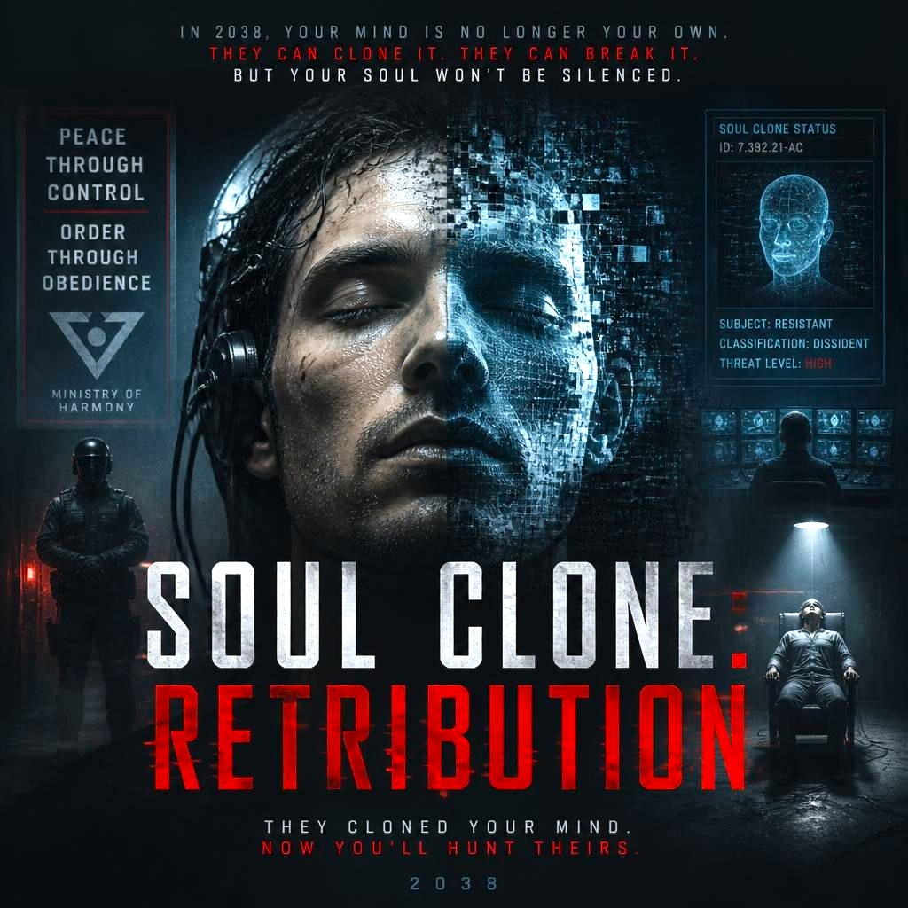

# Soul Clone: Retribution

The year is 2038. Governments secretly obtain brain scans of enemy combatants and all known anti-establishment dissidents. Using the latest Soul Clone tech, they create in-silico digital twins of millions of men and women. 

After a violent worldwide uprising against poverty and injustice, fascist regimes begin to use Soul Clone to profile, interrogate and virtually torture these digital twins - all in the name of maintaining peace and order.

But the lines begin to blur. Politicians and law enforcement desperate for more control over fracturing societies no longer just want to harm the *virtual* clones of its citizens. 

Using a twisted form of the Stanford Prison Experiment, interrogators are no longer aware if the entity they are torturing is human, virtual or even **something else entirely**.

*By Josiah Rhys Jacobson. Movie poster mockup via Leonardo AI.*
