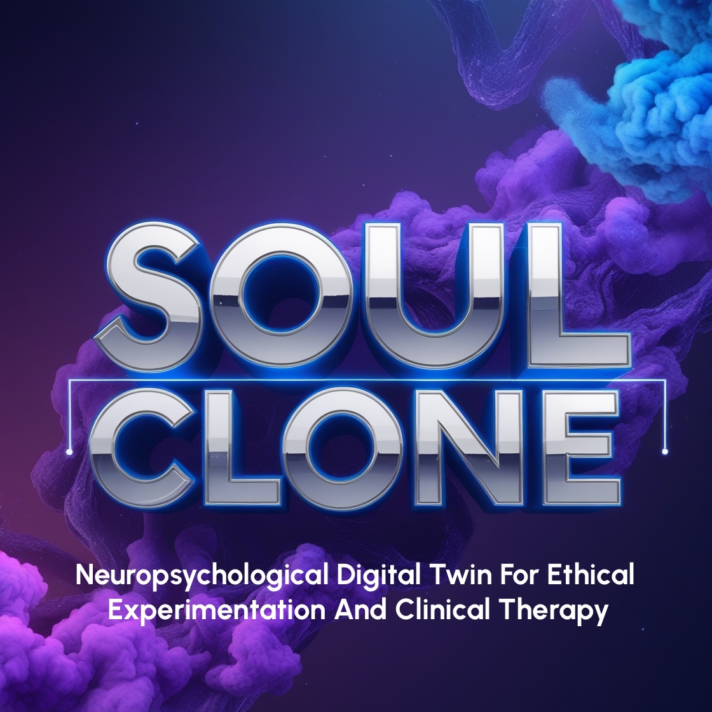

# Soul Clone



*A bounded, neuropsychologically-informed in-silico reflective twin for self-exploration, scenario planning, and decision support. By Josiah Rhys Jacobson*

## Abstract

**Soul Clone** is a research platform investigating whether a personalised, multimodal, in-silico model can help an individual reflect on how they might feel, decide, and behave under a limited set of scenarios they have not yet, or cannot safely, experience in real life.

The goal is not to construct a complete clone of a person, or an autonomous decision-maker. Rather, the project explores a more modest and defensible idea: a **bounded reflective twin** that combines neuroscience, psychometrics, physiology, behavioural traces, and narrative history to support self-understanding, scenario planning, and low-risk therapeutic rehearsal.

The system is designed as a research probe, not a final clinical or moral authority. It may be useful for:

- **Self-reflection**: clarifying motives, fears, habitual reactions, and decision patterns
- **Scenario planning**: comparing how the OG might respond under different future conditions
- **Ethical in-silico experimentation**: exploring stressors, trade-offs, and incentives in controlled, bounded settings
- **Clinical decision support**: generating hypotheses to discuss with a clinician rather than prescribing decisions

This is intentionally framed as a **mirror, not a substitute for the self**. The system aims to amplify insight, not replace agency.

---

## 1. Motivation

Current mental-health digital twins are either (a) descriptive population-level models, (b) single-modality (e.g., connectome → behaviour only), or (c) conversational self-clone systems that imitate a person’s voice without deeper biological or behavioural grounding.

**Soul Clone** sits at the intersection of these traditions. It asks whether a personalised model can do something more useful than either:

1. Individual connectomic structure (rs-fMRI, dMRI)
2. Psychometric and self-report data (Big Five, TCI, PDSS, DOSPERT)
3. Behavioural and physiological time-series (HRV, GSR, EEG)
4. Generative narrative capacity (the Clone can *speak* in the OG's voice)
5. Perturbation and intervention simulation (in-silico "what-if" experimentation)

The central hypothesis is not that we can reconstruct a full "soul" or inner essence. It is that a **partially grounded, uncertainty-aware model** may help an individual reason about how they are likely to respond to selected situations, and whether that model adds value beyond generic AI advice or self-report alone.

Soul Clone unifies these into a single, continuously-synchronised platform for bounded reflection and scenario exploration.

---

## 2. System Architecture

```
┌───────────────────────────────────────────────────────────────────┐
│                        SOUL CLONE PLATFORM                        │
├───────────────────────────────────────────────────────────────────┤
│                                                                     │
│  ┌───────────────┐    ┌──────────────────┐    ┌─────────────────┐ │
│  │  DATA LAYER   │───▶│  MECHANISTIC     │───▶│  GENERATIVE     │ │
│  │               │    │  CORE            │    │  LAYER          │ │
│  │ • rs-fMRI     │    │                  │    │                 │ │
│  │ • dMRI        │    │ • Hypernetwork   │    │ • LLM persona   │ │
│  │ • EEG/ERP     │    │   (connectome →  │    │   (OG's voice)  │ │
│  │ • HRV/GSR     │    │    weights)      │    │                 │ │
│  │ • Psychometrics│   │ • RNN main net   │    │ • Dream/night-  │ │
│  │ • Journals/   │    │   (task →        │    │   time sim      │ │
│  │   narratives  │    │    behaviour +   │    │                 │ │
│  │ • Wearables   │    │    BOLD)         │    │ • Scenario      │ │
│  │ • EHR (opt.)  │    │ • E/I gain ctrl  │    │   engine        │ │
│  └───────────────┘    │   (perturbation) │    └─────────────────┘ │
│                       └──────────────────┘                          │
│                              │                                      │
│                              ▼                                      │
│                       ┌──────────────────┐                          │
│                       │  REFLECTIVE      │                          │
│                       │  SCENARIO ENGINE │                          │
│                       │                  │                          │
│                       │ • Stressor sim   │                          │
│                       │ • Goal-framing   │                          │
│                       │ • Reward/effort  │                          │
│                       │ • High-pressure  │                          │
│                       │   simulations   │                          │
│                       │ • Counselling    │                          │
│                       │   roleplay       │                          │
│                       │ • Dream replay   │                          │
│                       └──────────────────┘                          │
│                                                                     │
│  ┌───────────────────────────────────────────────────────────────┐ │
│  │  REFLECTION INTERFACE  (mirror-style UX)                    │ │
│  │  • "What would I do?" queries                               │ │
│  │  • Scenario A/B comparison                                  │ │
│  │  • Therapist-mediated sessions                              │ │
│  │  • Insight reports and uncertainty bounds                   │ │
│  └───────────────────────────────────────────────────────────────┘ │
└───────────────────────────────────────────────────────────────────┘
```

### 2.1 Data Connection

| Modality | Source | Update Frequency |
|----------|--------|-----------------|
| Structural MRI / dMRI | Clinical scan | Annual |
| Resting-state fMRI | Clinical scan | 6-monthly |
| EEG / ERP | Lab or consumer headset | Per session |
| HRV, GSR, skin temp | Wearable (e.g., Apple Watch, Empatica) | Continuous |
| Psychometric scales | Self-report (Big Five, TCI, PDSS, DOSPERT, TEPS) | 3-monthly |
| Narrative / journal | App / voice log | Daily–weekly |
| Clinical notes | EHR (with consent) | Per encounter |

### 2.2 Mechanistic Core

Adapted from the **Digital Twin Brain** (DTB) architecture (Nakamura et al., 2026; BME Frontiers):

- **Hypernetwork** (MLP): maps the OG's individual rsFCM → personalised weights for the main network.
- **Main network** (RNN): given sensory/task input, generates predicted behaviour sequences *and* BOLD time-series.
- **E/I gain control layer**: excitatory/inhibitory synaptic conductance parameters that enable in-silico perturbation (inspired by pharmacological fMRI validation work).

Validation targets (from DTB literature): >90 % action-prediction concordance, RT correlation r > 0.85, BOLD correlation r ≈ 0.84.

These numbers indicate what is achievable in adjacent work, not a guarantee that this specific system will reach equivalent performance for an individual-level reflective twin.

### 2.3 Generative Layer

A large language model fine-tuned (or prompted via structured "soul files") on the OG's own language, values, and decision patterns. This layer gives the Clone *voice*—it can answer questions such as "What would I likely do in this situation?" or "How might my past patterns show up under stress?"

Key design principle: the Clone is **not** a perfect replica or predictive oracle. It is a **therapeutically calibrated, uncertainty-aware reflection**—selectively amplifying insight-relevant traits while preserving explicit boundaries around what is known, unknown, and unverified.

### 2.4 Scenario & Intervention Engine

| Scenario Type | Description | Ethical Guardrail |
|---------------|-------------|-------------------|
| **Stressor exposure** | Simulate job loss, bereavement, public failure, etc. | OG sets intensity ceiling; session auto-terminates if distress exceeds threshold |
| **Goal-framing** | Present the same goal in gain vs. loss frame; observe Clone's decision shift | Comparative output only; no prescriptive advice |
| **Excess / reward** | Simulate escalating reward schedules (gambling, social media, substance) | Capped at sub-clinical intensity; clinical referral trigger |
| **High-pressure simulations** | Simulate sustained psychological pressure (interrogation, isolation, uncertainty) | **Explicit OG consent per session**; hard time limit; immediate grounding protocol; not a core use case at early stages |
| **Dream replay** | Reconstruct likely dream content from sleep-stage data + diurnal affect; allow OG to "re-enter" and modify | Framed as exploratory, not diagnostic |
| **Counselling roleplay** | Clone acts as the OG in a therapist-mediated dialogue; or Clone acts as a specific other (partner, boss) for rehearsal | Therapist present; Clone outputs flagged as speculative reflections |
| **Virtual questions** | OG asks the Clone questions they cannot ask themselves (e.g., "Why do I keep choosing X?") | Clone must hedge; outputs positioned as prompts, not truths |

This engine is designed for reflective inquiry, not autonomous behavior or decision replacement.

---

## 3. Clinical & Personal Applications

1. **Path-forward insight**: Before a major life decision (career change, relationship, surgery), the OG runs the scenario on the Clone and receives a *distribution* of likely responses, not a single deterministic prediction.
2. **Therapeutic rehearsal**: Practise difficult conversations or confront fears in a safe in-silico environment before real-world exposure.
3. **Treatment optimisation**: In partnership with a psychiatrist, simulate how the OG's connectome responds to pharmacological or neuromodulatory interventions (TMS, tDCS) before applying them in practice.
4. **Relapse prediction**: Continuous wearable data feeds the twin; the system flags rising risk of anxiety/depressive episodes (ROC-AUC > 0.93 in physics-informed stress-twin literature).
5. **Research**: Aggregate (de-identified) Clone responses to build population-level models of neuroses, fear generalisation, and dream content.

These applications are framed as **decision support and reflection tools**, not clinical diagnoses or autonomous command systems.

---

## 4. Icon / Visual Identity

**Concept: The Reflection**

The Soul Clone icon is a **mirror** — specifically, a *slightly distorted* reflection. The design language:

- A circular or oval mirror frame (suggesting the self, the whole)
- The reflected face is *almost* identical but with a subtle, intentional asymmetry or ripple (the Clone is close but not the OG; it is an approximation)
- A single thin line of light emanates from the mirror surface (insight, the "aha" moment)
- Palette: deep indigo / violet (introspection, the unconscious) with a single warm accent (the self, the OG)
- No eyes in the reflection (the Clone observes but does not judge; the OG is the one who looks)

This evokes the *mirror test* of self-recognition while signalling that what you see is a model, not the thing itself.

---

## 5. Ethical Framework

| Principle | Implementation |
|-----------|---------------|
| **OG sovereignty** | The OG can pause, modify, or delete the Clone at any time. No third party accesses the Clone without explicit, revocable consent. |
| **No autonomous action** | The Clone never acts in the world (no emails sent, no decisions made). It only *reflects*. |
| **Hedged outputs** | All Clone statements use first-person hedging ("One way I might feel…", "I might be drawn to…") to prevent over-identification. |
| **Crisis detection** | If simulated or reported affect crosses a clinical threshold, the system pauses and routes to a human clinician. |
| **Transparency** | The Clone's artificial nature is disclosed at onboarding and re-surfaced at high-stakes moments (just-in-time disclosure per CHI 2026 framework). |
| **Data minimisation** | Only data necessary for the specific simulation is retained. Connectomic data is stored encrypted; raw fMRI is discarded after parameter fitting. |
| **No extreme simulation without safeguards** | High-distress or high-pressure simulations require: (a) explicit per-session consent, (b) a pre-agreed stop-word, (c) a 24-hour cooldown before re-entry, (d) automatic exclusion if trauma triggers are present, and (e) human review for repeated use. |
| **Human oversight** | The Clone is a support tool. Final decisions remain with the OG and/or their clinician. |

This framework is necessary because the same capability that supports reflection can also be misused for persuasion, coercion, or overconfidence in speculative predictions.

---

## 6. Prior Art & Existing Publications

### 6.1 Digital Twin Brain / Connectome-to-Behaviour

| Ref | Citation | Relevance |
|-----|----------|-----------|
| [1] | Nakamura, K. et al. (2026). *Digital Twin Brain: Generating Multitask Behavior from Connectomes for Personalized Therapy.* **BME Frontiers**, 4(1). DOI: 10.34133/bmef.0231. | Core architecture for connectome-to-behaviour modelling. |
| [2] | Nakamura, K. et al. (2026). *Digital Twin Brain simulation and manipulation of a functional brain network underlying mental illness.* **BME Frontiers** / bioRxiv 2026.03.06.710030. | Neural simulation and perturbation of psychiatric states. |
| [3] | Tadel, F. et al. (2024). *Virtual brain twins: from basic neuroscience to clinical use.* **National Science Review**, 11(5), nwae079. | Subject-specific whole-brain network models for epilepsy and cognition. |
| [4] | *Virtual Brain Twin for personalised treatment of Psychiatric Disorders* (Cordis, EU Horizon, 2024–2027). Project ID 101137289. | EU-funded ecosystem for virtual brain twins in psychiatric care. |
| [5] | *Virtual brain twins guide personalized treatment decision in schizophrenia.* **medRxiv**, 2026.05.06.26352533. | First VBT pipeline integrating structural connectivity, cortical thickness, and intervention prediction. |

### 6.2 Self-Clone / AI Mirror (Conversational Layer)

| Ref | Citation | Relevance |
|-----|----------|-----------|
| [6] | *Cloning the Self for Mental Well-Being: A Framework for Designing Safe and Therapeutic Self-Clone Chatbots.* **CHI 2026**, Article 994. DOI: 10.1145/3772318.3790986. arXiv:2601.15465. | Framework for safe and therapeutic self-clone conversational design. |
| [7] | *Talking to an AI Mirror: Designing Self-Clone Chatbots for Enhanced Engagement in Digital Mental Health Support.* **arXiv:2509.06393** (2025). | N=180 experiment; self-clone > generic chatbot for engagement. |
| [8] | *Mirror to Companion: Exploring Roles, Values, and Risks of AI Self-Clones through Story Completion.* **ACM** (2025). DOI: 10.1145/3706598.3713587. | 20-participant study on values/risks of self-clone dialogue. |
| [9] | *Responsible cognitive digital clones as decision-makers: a design science research study.* **Journal of Decision Systems** (Tandfonline), 2022. DOI: 10.1080/0960085X.2022.2073278. | Design lessons for cognitive digital clones and governance. |
| [10] | *Learning through AI-clones: Enhancing self-perception and presentation performance.* **ScienceDirect** (2025). | AI-clone for self-perception; goal-setting; emotional resonance. |

### 6.3 Neuropsychological / Biomimetic Digital Twins

| Ref | Citation | Relevance |
|-----|----------|-----------|
| [11] | *Digital Twin Cognition: AI-Biomarker Integration in Biomimetic Neuropsychology.* **Biomimetics**, 10(10), 640 (2025). DOI: 10.3390/biomimetics10100640. | Systematic review of AI + biomarkers in neuropsychological modelling. |
| [12] | *Blocking the Reflection: Milestones and Hurdles for Digital Twins in Mental Health.* **PubMed** 41856487 (2026). | Historical perspective; clinical decision support; large behavioural models. |
| [13] | *Surrogate Human Digital Twins (S-HDT) for Neuroergonomics.* **Frontiers in Neuroergonomics**, 2026. | Free-energy-minimisation framework; predictive cognitive simulation; workload prediction. |
| [14] | *A physics-informed digital twin framework for personalized stress prediction.* **ScienceDirect** (2026). | Nonlinear ODEs + ML + Bayesian assimilation; HRV, cortisol, sleep; ROC-AUC > 0.90. |

### 6.4 Medical Digital Twins (General Framework)

| Ref | Citation | Relevance |
|-----|----------|-----------|
| [15] | *Medical digital twins: enabling precision medicine and medical artificial intelligence.* **The Lancet Digital Health** (2025). | Five pillars: patient, data connection, patient-in-silico and continuous adaptation. |
| [16] | *Enhancing randomized clinical trials with digital twins.* **Nature Biomedical Engineering** (2025). DOI: 10.1038/s41540-025-00592-0. | AI-generated virtual patients as synthetic controls. |
| [17] | *AI-powered in silico twins: redefining precision medicine through simulation, personalization, and predictive healthcare.* **Springer** (2025). DOI: 10.1007/s44446-025-00055-x. | Model-guided personalised intervention design. |
| [18] | *Digital twins in healthcare: a comprehensive review and future directions.* **PMC** 12671388 (2025). | Risk-free experimentation; perturbation prediction; cellular to whole-body. |
| [19] | *Digital twin for neurological conditions: a systematic scoping review.* **PMC** 13615232 (2026). | Predictive + actionable frameworks; in-silico intervention testing. |
| [20] | *Generative artificial intelligence empowers digital twins in drug discovery and clinical trials.* **PubMed** 37887266 (2023). | DTs for in-silico drug testing; reduces ethical burden. |

### 6.5 Scenario Planning / Future Self

| Ref | Citation | Relevance |
|-----|----------|-----------|
| [21] | *Simulating Life Paths with Digital Twins: AI-Generated Future Selves Influence Decision-Making and Expand Human Choice.* **UCLA Anderson Review** / arXiv:2512.05397 (2025). | N=192 RCT; future-self simulation influences decision-quality. |
| [22] | *Optimal Personalised Treatment Computation through In Silico Clinical Trials on Patient Digital Twins.* **arXiv:2106.10684**. | VPH model of HPG axis; in-silico treatment search on individual patients. |

### 6.6 Therapeutic AI (Adjacent)

| Ref | Citation | Relevance |
|-----|----------|-----------|
| [23] | Heinz, M.F. et al. (2025). *Randomized Trial of a Generative AI Chatbot for Mental Health Treatment (Therabot).* **NEJM AI**, 2(3). | First RCT of generative AI therapy; N=210; d = 0.63. |
| [24] | *PsyDT: Using LLMs to Construct the Digital Twin of Psychological Counselor with Personalized Counseling Style.* **ACL 2025 Findings** (SoulChat 2.0). | Digital twin of *counselor* (not patient). |
| [25] | *Perceived Support Is Not Psychological Change: Reframing AI Chatbots in Mental Health Care.* **PMC** 13515344 (2026). | Structured mirroring vs. intersubjective engagement; limits of chat-based support. |

### 6.7 Philosophical / Identity (Contextual)

| Ref | Citation | Relevance |
|-----|----------|-----------|
| [26] | *Digital Soul Continuity Model (DSCM) / SoulEcho Theory.* Akhil Suresh (2025). | Digital preservation of emotional/cognitive identity; ethical AI design for "digital lifeforms". |
| [27] | *Metaverse and Human Digital Twin: Digital Identity, Biometrics, and Privacy in the Future Virtual Worlds.* **MDPI Multimodal Technologies and Interaction** (2024). | Soulbound token as digital identity; privacy considerations. |
| [28] | Richert, R. & Harris, C. (2024). *Would Your Clone Have a Soul?* **Scientific American** (Bering in Mind). | 67 % believe human clone has a mind; only 32 % believe it has a soul. |

---

## 7. Differentiation from Prior Art

| Dimension | DTB [1,2] | Self-Clone Chatbots [6,7] | Soul Clone |
|-----------|-----------|---------------------------|------------|
| Neurocognitive substrate | ✅ Connectome → behaviour | ❌ LLM only | ✅ Connectome + psychometrics + physiology |
| Generative narrative | ❌ | ✅ | ✅ (OG's own voice) |
| In-silico perturbation | ✅ (E/I, pharmacological) | ❌ | ✅ (stressors, reward, high-pressure scenarios) |
| Scenario planning | ❌ | Partial (dialogue only) | ✅ (structured A/B, multi-step) |
| Therapeutic rehearsal | ❌ | Partial | ✅ (counselling roleplay, virtual questions) |
| Dream modelling | ❌ | ❌ | ✅ (sleep-stage + affect → dream replay) |
| Continuous synchronisation | ❌ (snapshot) | Partial | ✅ (wearable + periodic scan) |
| Ethical guardrails | N/A | General | ✅ (per-session consent, hard limits, crisis routing) |
| Claim level | High factual grounding | High engagement | Moderate; reflective, bounded and uncertainty-aware |

The key difference is not that Soul Clone is a full clone of the self. It is that it attempts to integrate multiple modalities into a single reflective and scenario-planning tool while preserving explicit uncertainty and guardrails.

---

## 8. Research Questions

1. **RQ1**: To what extent can a multimodal neuropsychological digital twin (connectome + psychometrics + physiology + narrative) predict the OG's affective and behavioural responses to controlled, low-risk scenarios?
2. **RQ2**: Does interacting with one's own reflective Clone (vs. a generic AI counselor) produce greater insight, self-awareness, and decision-quality improvement?
3. **RQ3**: Can in-silico perturbation of the Clone's E/I parameters predict the OG's response to real-world pharmacological or neuromodulatory interventions?
4. **RQ4**: What are the psychological risks (identity confusion, rumination amplification, over-identification) of sustained interaction with a high-fidelity self-Clone, and what design mitigations are effective?
5. **RQ5**: Under what conditions are bounded, consensual psychological stress simulations useful for reflection and resilience training, and when do they become clinically or ethically inappropriate?

These questions are intentionally modest and testable. They do not assume the Clone is a full digital mind or a substitute for human judgment.

---

## 9. Proposed Study Design (Phase 1 Pilot)

- **N**: 30–50 adults (18–65), mixed clinical (mild–moderate anxiety/depression) and healthy controls
- **Data**: 1× rs-fMRI + dMRI scan, 1× EEG session, 4 weeks of wearable data (HRV, GSR, sleep), baseline psychometrics
- **Intervention**: 8 weeks of weekly 45-min sessions with the Clone (scenario planning, virtual questions, and a limited number of low-risk stressor scenarios)
- **Controls**: (a) generic AI counselor (no personalisation), (b) waitlist
- **Outcomes**: Decision-quality (DOSP), self-awareness (TAS-20), stress reactivity (lab-based), clinical symptom scales (PHQ-9, GAD-7), qualitative interviews
- **Safety**: Clinical monitor on standby; session termination protocol; 24-hr post-session check-in; explicit rules for escalation and model abstention

The pilot is focused on evaluation and safety, not on proving that the Clone can represent the whole person or make consequential decisions on their behalf.

---

## 10. Open Challenges

- **Validation**: How to validate a neuropsychological twin that models *subjective* experience? (Behavioural concordance? fMRI BOLD match? Self-report agreement?)
- **Fidelity vs. safety trade-off**: A more faithful Clone may be more therapeutically useful but also more capable of reinforcing harmful patterns.
- **The high-distress simulation question**: Ethical review boards may not have precedent. A novel IRB protocol and a dedicated ethics sub-study are required.
- **Identity and consent over time**: The OG changes. When does the Clone become "stale"? Who decides to update it?
- **Data ownership**: The connectome is arguably the most sensitive biometric. A data-sovereignty model (on-device processing, federated learning) is essential.
- **Misuse risk**: The same reflective system could be repurposed for interrogation, employment screening, behavioural influence, or coercive applications. Guardrails must be explicit and enforceable.

---

## 11. Timeline (3-Year)

| Phase | Duration | Milestone |
|-------|----------|-----------|
| **P0 – Architecture** | Months 1–6 | Core DTB + generative layer integrated; 5 pilot users |
| **P1 – Pilot RCT** | Months 7–18 | N=30–50; primary outcomes; safety report |
| **P2 – Scenario Engine** | Months 12–24 | Full scenario library (stressor, reward, dream, low-risk pressure exposures); ethical framework peer-reviewed |
| **P3 – Clinical Partnership** | Months 18–36 | Multi-site trial (N=200+); treatment-optimisation arm; regulatory submission (SaMD) |

---

## 12. References (Full)

1. Nakamura, K., et al. (2026). Digital Twin Brain: Generating Multitask Behavior from Connectomes for Personalized Therapy. *BME Frontiers*, 4(1). https://doi.org/10.34133/bmef.0231
2. Nakamura, K., et al. (2026). Digital Twin Brain simulation and manipulation of a functional brain network underlying mental illness. *bioRxiv* 2026.03.06.710030.
3. Tadel, F., et al. (2024). Virtual brain twins: from basic neuroscience to clinical use. *National Science Review*, 11(5), nwae079.
4. EU Horizon. (2024–2027). *Virtual Brain Twin for personalised treatment of Psychiatric Disorders.* Cordis Project 101137289.
5. (2026). Virtual brain twins guide personalized treatment decision in schizophrenia. *medRxiv* 2026.05.06.26352533.
6. (2026). Cloning the Self for Mental Well-Being: A Framework for Designing Safe and Therapeutic Self-Clone Chatbots. *CHI 2026*, Article 994. https://doi.org/10.1145/3772318.3790986
7. (2025). Talking to an AI Mirror: Designing Self-Clone Chatbots for Enhanced Engagement in Digital Mental Health Support. *arXiv:2509.06393*.
8. (2025). Mirror to Companion: Exploring Roles, Values, and Risks of AI Self-Clones through Story Completion. *ACM*. https://doi.org/10.1145/3706598.3713587
9. (2022). Responsible cognitive digital clones as decision-makers. *Journal of Decision Systems*. https://doi.org/10.1080/0960085X.2022.2073278
10. (2025). Learning through AI-clones: Enhancing self-perception and presentation performance. *ScienceDirect*.
11. (2025). Digital Twin Cognition: AI-Biomarker Integration in Biomimetic Neuropsychology. *Biomimetics*, 10(10), 640. https://doi.org/10.3390/biomimetics10100640
12. (2026). Blocking the Reflection: Milestones and Hurdles for Digital Twins in Mental Health. *PubMed* 41856487.
13. (2026). Surrogate Human Digital Twins for Neuroergonomics. *Frontiers in Neuroergonomics*.
14. (2026). A physics-informed digital twin framework for personalized stress prediction. *ScienceDirect*.
15. (2025). Medical digital twins: enabling precision medicine and medical artificial intelligence. *The Lancet Digital Health*.
16. (2025). Enhancing randomized clinical trials with digital twins. *Nature Biomedical Engineering*. https://doi.org/10.1038/s41540-025-00592-0
17. (2025). AI-powered in silico twins: redefining precision medicine. *Springer*. https://doi.org/10.1007/s44446-025-00055-x
18. (2025). Digital twins in healthcare: a comprehensive review and future directions. *PMC* 12671388.
19. (2026). Digital twin for neurological conditions: a systematic scoping review. *PMC* 13615232.
20. (2023). Generative artificial intelligence empowers digital twins in drug discovery and clinical trials. *PubMed* 37887266.
21. (2025). Simulating Life Paths with Digital Twins: AI-Generated Future Selves Influence Decision-Making. *arXiv:2512.05397*.
22. (2021). Optimal Personalised Treatment Computation through In Silico Clinical Trials on Patient Digital Twins. *arXiv:2106.10684*.
23. Heinz, M.F., et al. (2025). Randomized Trial of a Generative AI Chatbot for Mental Health Treatment. *NEJM AI*, 2(3).
24. (2025). PsyDT: Using LLMs to Construct the Digital Twin of Psychological Counselor. *ACL 2025 Findings*.
25. (2026). Perceived Support Is Not Psychological Change: Reframing AI Chatbots in Mental Health Care. *PMC* 13515344.
26. Suresh, A. (2025). Digital Soul Continuity Model. *Academia.edu*.
27. (2024). Metaverse and Human Digital Twin: Digital Identity, Biometrics, and Privacy. *MDPI Multimodal Technologies and Interaction*.
28. Richert, R. & Harris, C. (2024). Would Your Clone Have a Soul? *Scientific American*.

---

*Status: Research Proposal v0.1 — for internal review and IRB pre-submission.*
